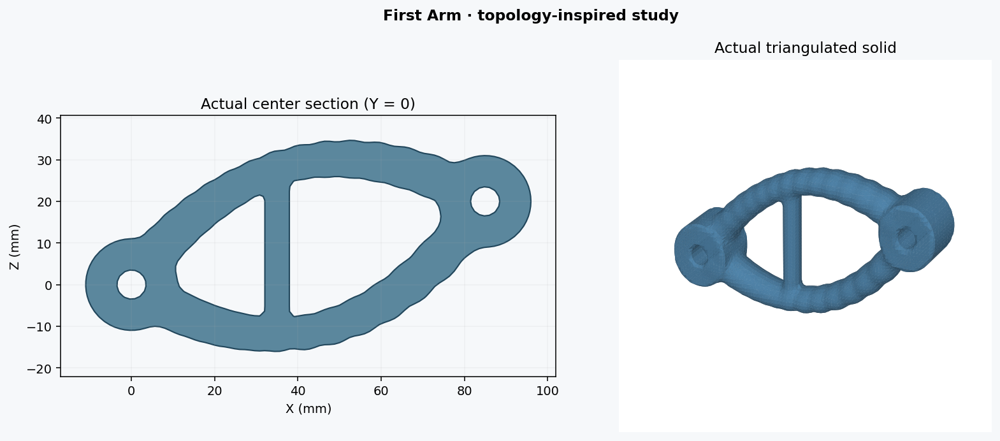
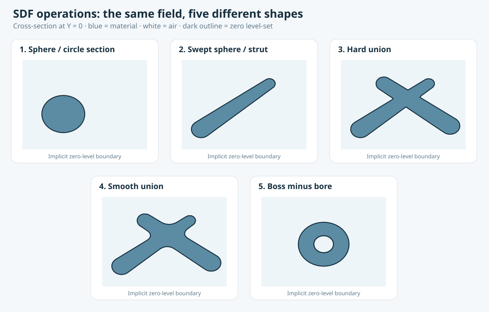
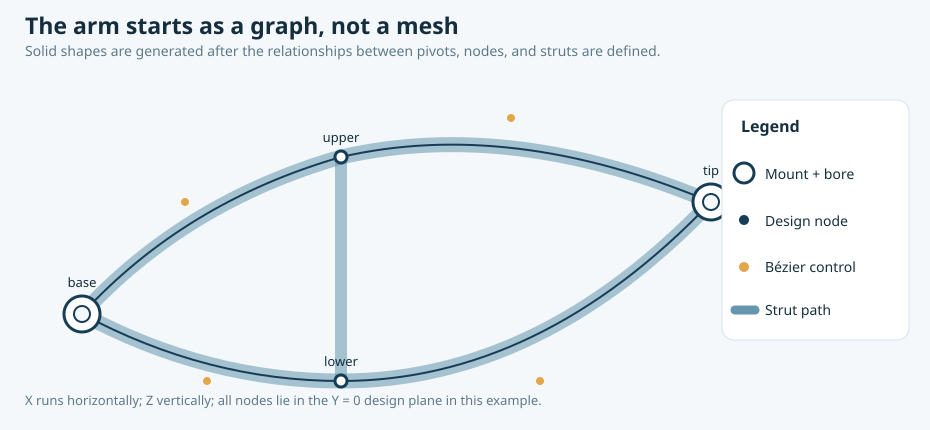
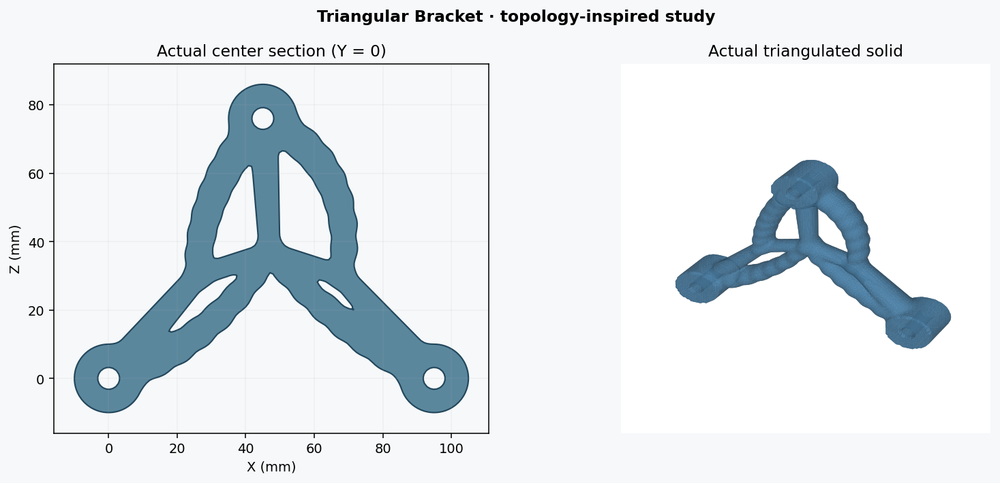

# Organic Geometry Workbench

**Learn to write organic, branching 3D structures in Python — from one sphere to your own printable-looking camera arm.**


This repository is a **course you can execute**, not a collection of mysterious model snapshots. Every example has a reason to exist: you will learn what a line of code means geometrically, predict how changing it affects the shape, run it, then check what actually happened.

A camera-arm sculpture can resemble a topology-optimized part without being mechanically optimized. **The models here are topology-inspired, not load-rated or FEA-verified.** That's not a disclaimer to hide behind; it is the engineering boundary we will learn to test.

## By the end, you will be able to

- Translate a drawing into an axis convention, measured mounting datums, a **node/edge graph**, and a JSON design specification.
- Implement a sphere field, sweep it along a segment, taper it, and bend it along a Bézier path.
- Join struts with a controlled smooth union, add bosses, subtract exact *nominal* holes, and explain the order of those operations.
- Sample a signed-distance field on a voxel grid, extract a triangle mesh, and understand resolution artifacts.
- Build a new organic arm without copying an old generator, render its actual mesh, and report what you **can and cannot verify**.

No Blender installation is needed to generate geometry. Blender (`bpy`) is an optional visualization backend.

## Start here (10 minutes)

Python 3.10+ on macOS, Linux, or Windows. Open a terminal at the repository root:

```bash
python3 -m venv .venv
source .venv/bin/activate                  # Windows PowerShell: .venv\Scripts\Activate.ps1
python -m pip install -e .
python -m organic.field_lab --out results/field_lab.png
python -m organic.build examples/first_arm.json
```

Expected results:

- `results/field_lab.png` — five contour plots showing how the geometry equations work.
- `results/first_arm/first_arm.stl` — a real triangle mesh.
- `results/first_arm/preview.png` — a cross-section and 3D render **of that mesh**.
- `results/first_arm/validation.json` — measured mesh properties, with limitations.

Run `python -m unittest discover -s tests -v` to verify the SDF math and example build. If installation fails, see [Troubleshooting](docs/TROUBLESHOOTING.md).



This is the **first-arm course example**, generated from the JSON graph we will examine below. The dark cutouts are voids, not painted surfaces.


## The idea: a sphere swept along a path

Before you write Blender modifiers, try this mental image: put a small sphere at a point, move its center along a line, and retain every position it occupied. The union of those spheres forms a capsule-like **strut**. If the radius changes along the line, it tapers.

We don't literally animate thousands of spheres. We calculate the *distance from any position to the nearest point on the path* and subtract the desired radius. That one equation describes the whole solid.



These diagrams are 2D sections of mathematically computed fields, not photorealistic renders or structural simulations.

### Step 1 — Understand the sign

A signed-distance field (SDF) returns a number for every point `p`:

- `d(p) < 0`: inside material
- `d(p) = 0`: surface
- `d(p) > 0`: outside material

For a sphere centered at `c` with radius `r`:

\[d(p) = \|p-c\| - r\]

Suppose `c = (0,0,0)` and `r = 4 mm`. The center has distance `-4 mm`, a point four millimeters away is on the surface, and a point six millimeters away has distance `+2 mm`. **Prediction:** increasing `r` moves the surface outward. It does not move the center.

### Step 2 — Turn that sphere into a strut

For endpoints `a`, `b`, project `p` onto the segment. Clamp the projection so it cannot extend beyond either endpoint:

```python
v = b - a
t = np.clip(np.dot(p - a, v) / np.dot(v, v), 0.0, 1.0)
closest = a + t * v
radius = radius_start + t * (radius_end - radius_start)
distance = np.linalg.norm(p - closest) - radius
```

The real project function is [`organic/fields.py::segment_distance`](organic/fields.py). It works on entire NumPy arrays, not just one point. When the two radii differ, this is an **approximate tapered field**, not an exact Euclidean distance to a true cone. That distinction matters for dimension-critical CAD.

### Step 3 — Bend the centerline, not the mesh

Instead of one straight segment, create sample points on a quadratic Bézier curve:

\[B(t)=(1-t)^2 A+2(1-t)t C+t^2 B\]

`A` and `B` are endpoints. `C` is the **control point**, which pulls the path toward itself. The generator links adjacent samples using swept struts, producing an approximate curved beam. More samples make the centerline approximation finer, but don't automatically improve voxel resolution.

**Experiment:** change the `control` point on the lower strut in [`examples/first_arm.json`](examples/first_arm.json) from `[17, 0, -12]` to `[17, 0, -22]`. Predict which way the beam bends before regenerating. [Why Bézier curves work](docs/03-curves-and-branches.md).

### Step 4 — Combine material, subtract air

For the negative-inside convention, a hard union is `min(d1, d2)`. It leaves a distinct junction. `smooth_union(d1,d2,k)` adds a rounded transition; larger `k` changes more of the joint and can add material. Neither technique magically knows forces or stresses.

A boss is a finite cylinder. A bolt hole is another cylinder, used as a **cutter**:

```python
solid = smooth_union(struts, boss, blend_mm)
solid = np.maximum(solid, -hole)  # difference: subtract the bore
```

**Why cut last?** Smoothing after drilling could grow material back into the bolt hole. The starter deliberately creates bosses before applying hard hole exclusions. The final mesh is voxelized, so measure an exported bore instead of assuming the specified nominal diameter is exact.

### Step 5 — Turn the field into an STL

The generator evaluates the field on a 3D grid (`voxel_mm`) and uses **marching cubes** to find triangles along the zero level-set. No Blender scene is needed. Smaller voxels usually improve geometric detail but cost more memory and time; this is a discretized approximation, not perfect CAD boundary representation. See [Sampling, meshing and why artifacts happen](docs/05-mesh-and-verification.md).

## Build the arm deliberately, not by accident



The diagram corresponds to the four named nodes and five struts in [`examples/first_arm.json`](examples/first_arm.json). All coordinates are **millimeters**. The two mounts are centered at `base = [0,0,0]` and `tip = [85,0,20]`; the hole axes run along **Y** in this starter. That yields an 85 mm X separation and 20 mm Z rise, **not** an 85 mm total straight-line center distance.

Try this complete editing loop:

1. Copy `examples/first_arm.json` to `examples/my_first_arm.json`; change its `name` to `my_first_arm` so outputs do not overwrite the original example.
2. Move only the `upper` node's Z coordinate from `28` to `35`. Predict which connected struts will move. The bolt centers should stay fixed.
3. Change a `radius_b_mm` from `3.5` to `4.2`. Predict which end thickens, and why volume alone does **not** prove strength increased.
4. Run `python -m organic.build examples/my_first_arm.json`. Compare its preview with `results/first_arm/preview.png`.
5. Explain one difference in your own words using **geometry terms**: endpoint, control point, radius, blend, or bore.

To compare total mesh volumes *without claiming a strength result*:

```bash
python -m organic.compare examples/first_arm.json examples/my_first_arm.json
```

This writes `results/design_comparison.json` and lists bounding boxes, volume and watertightness. Change only one variable at a time if you want to understand cause and effect.

## Follow the curriculum

| Chapter | What you learn | What you produce |
|---|---|---|
| [01 · Coordinates and design intent](docs/01-coordinate-frames.md) | Datums, axes, graphs, dimensions | An annotated mount/strut graph |
| [02 · Distance fields from first principles](docs/02-distance-fields.md) | The sign convention, sphere, capsule, closest-point projection | Explain and verify the `segment_distance()` equation |
| [03 · Curves and branching](docs/03-curves-and-branches.md) | Quadratic Bézier paths, sampling, taper and blending | A deliberate change to a branching beam |
| [04 · Bosses, holes and constraints](docs/04-constraints-and-holes.md) | Protected features, subtraction order, keep-outs | A safe bore and clearance revision |
| [05 · Meshing and verification](docs/05-mesh-and-verification.md) | Sampling cost, marching cubes, artifact diagnosis | A documented before/after comparison |
| [06 · Blender and beyond](docs/06-blender-and-engineering.md) | What `bpy` adds; limits of topology-inspired designs | A rendered model with engineering notes |
| [Capstone · Make your own arm](docs/CAPSTONE.md) | From sketch through source, render and tests | A shareable reproducible design package |

Start with the README even if you are completely new to SDFs; the chapters expand the reasoning and give exercises with expected outcomes. Definitions are in the [Glossary](docs/GLOSSARY.md).

## See the more complex starting examples



The larger [`camera_arm.json`](examples/camera_arm.json) and [`triangular_bracket.json`](examples/triangular_bracket.json) use **the same functions** as `first_arm.json`. Only their JSON graph changes. That separation — *design data versus general-purpose geometry code* — is the point of this repository.

## The code map

| File | Responsibility |
|---|---|
| `organic/fields.py` | Geometry vocabulary: tapered segment distance, capped Y cylinder, Bézier points, smooth union |
| `organic/build.py` | Read JSON → validate → sample → boolean ops → mesh → STL/validation/preview |
| `organic/preview.py` | Inspect actual triangle mesh and a Y=0 section |
| `organic/field_lab.py` | Compute and plot the five field operations for teaching |
| `organic/compare.py` | Compare two generated meshes without substituting volume for FEA |
| `blender_import.py` | Optional Blender scene, materials, lights, render and `.blend` |
| `tests/` | Reproducible mathematical and build checks |

## Export into Blender (optional)

On macOS with Blender installed at the standard path:

```bash
/Applications/Blender.app/Contents/MacOS/Blender --background \
  --python blender_import.py -- results/first_arm/first_arm.stl
```

The script creates a `.blend` and an additional PNG beside the STL. Blender **is not** the geometry algorithm here; it handles presentation. For a different operating system, invoke your local Blender executable with the same `--background --python … --` arguments.

## What this does **not** certify

Watertightness and a successful STL export mean the mesh is closed. They do not prove that bolts fit, a print succeeds, the wall thickness meets a machine/material minimum, or a load path can carry your camera. The curved strut centerline is piecewise sampled, tapered distances and smooth unions are approximate, and mounting bores can shift by voxel-scale errors. For a working camera rig, verify fit, load cases, print direction, fastener bearing, and a real structural analysis separately.

**Your next independent milestone:** complete the [capstone](docs/CAPSTONE.md) and explain *why* each strut exists, *which parameters* control it, and *which tests* support your claims. That's a better engineering skill than memorizing a particular Blender operator.
