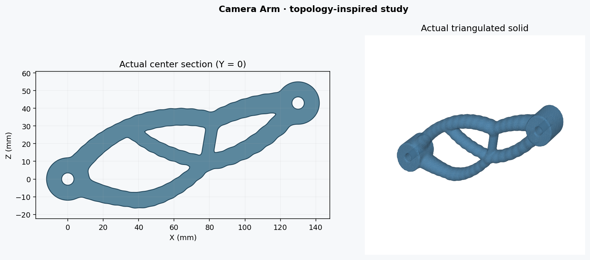

# Organic Geometry Workbench — reusable Python-first generative CAD starter

This is a **working educational geometry engine**, not a camera-arm load-certified design. It intentionally separates design data from geometry algorithms and from Blender rendering.

## Real geometry previews




## Files

- `organic/fields.py`: small, reusable geometry vocabulary (capsule, cylinder, smooth union, curved segments)
- `organic/build.py`: design-file → signed-distance field → marching-cubes STL and validation
- `organic/preview.py`: actual model renders, no AI pictures
- `examples/camera_arm.json`: two-pivot open truss example
- `examples/triangular_bracket.json`: three-point organic mounting bracket example
- `blender_import.py`: optional Blender material, `.blend`, and rendered PNG
- `results/`: actual generated mesh files and validation reports

## Install and run with ordinary Python

From the `organic_geometry_workbench` folder:

```bash
python3 -m venv .venv
source .venv/bin/activate
python -m pip install numpy scipy scikit-image trimesh matplotlib
python -m organic.build examples/camera_arm.json
python -m organic.build examples/triangular_bracket.json
```

This produces `results/camera_arm/camera_arm.stl` and the equivalent triangular bracket.

## Open/render in Blender

```bash
/Applications/Blender.app/Contents/MacOS/Blender --background \
  --python blender_import.py -- results/camera_arm/camera_arm.stl
```

This produces `.blend` and `.blender.png` in `results/camera_arm/` on a supported Blender setup.

## Understand the five layers

1. **Design constraints:** coordinate frames, mounting-hole centers, connection points, keep-outs and required clearances.
2. **Load paths (conceptual):** a node-and-strut graph specifying where material may be placed. At this stage the paths are **designer-defined**, not FEA-computed.
3. **Solid math:** signed-distance fields for rounded beams and bosses; smooth union blends branches. Holes use hard Boolean difference.
4. **Mesh extraction:** marching cubes converts the implicit solid to a triangle mesh, which is exported as STL.
5. **Validation and presentation:** watertightness, component count, volume, previews, followed by **real engineering checks** for loads and printability.

## Try your own design

Duplicate `examples/camera_arm.json` with a new name. Change `nodes`, `struts`, and `mounts`. Re-run the same command. No need to duplicate the Python generator. Increase `voxel_mm` to iterate faster; decrease it for more detailed output at greater computational cost. Struts can bend through a `control` point, which makes a quadratic Bézier curve. Radii can taper with `radius_a_mm` and `radius_b_mm`.

## Where Voronoi comes in

The previously supplied `generate_inverted_voronoi.py` computes a **scalar pattern over an existing roof height map**. This workbench instead combines **3D distance fields for connected struts and mounts**. Both are instances of the same underlying pattern: `parameters -> mathematical field -> mesh -> tests`.

For Voronoi-style cells in an arm, a future module could seed a graph within the permitted design volume and use a Voronoi/Delaunay network to propose struts, then prune against keep-outs. Do **not** conflate that with topology optimization: real optimization requires load cases, boundary conditions, material properties, a physics solver, and convergence/verification.

## Engineering limitations

- These are topology-**inspired** procedural geometries, NOT stress-optimized designs.
- Mounts are Y-axis bores for this teaching example. Their center distances are illustrative.
- Hole diameters, fits, printing orientation, support, anisotropy, loads, fatigue, and fastener bearing capacity are NOT validated.
- The smooth-union field is approximate; mesh grid discretization may shift surfaces by ~voxel-scale amounts. Functional mounting faces should be dimensionally checked or reconstructed parametrically for production.
- In Blender, the renderer smooths normals for appearance; this does not alter the manufacturing geometry.
