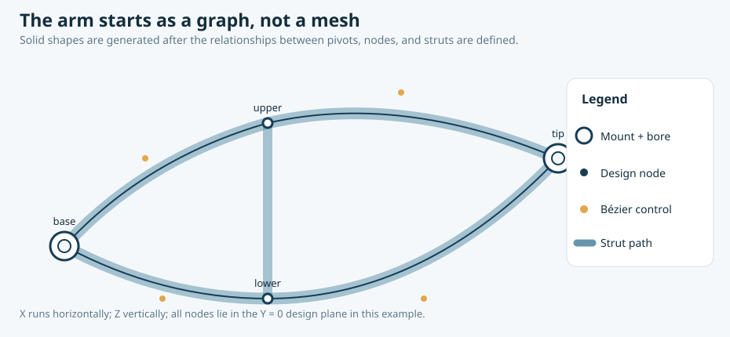

# 01 — Draw the constraints before drawing the organic surface

**Question:** How do we tell a program what a camera arm must connect, without telling it every triangle to create?

Start with a tiny engineering drawing: two pivot centers, a few intermediate points, and paths connecting them. The geometry engine can grow material around those paths. If you skip this stage, you have a nice sculpture but no clear explanation of why anything is located where it is.

## Coordinates: choose a convention once

Our examples use **millimeters**, with X running from base toward the camera, Z upward, and Y through the arm's thickness. The mounts in this starter are cylinders with their bore axis along **Y**, so the hole looks circular when you look at the X/Z elevation.

`base=[0,0,0]` and `tip=[85,0,20]` mean that the tip is 85 mm ahead of the base *and* 20 mm higher. The straight-line distance is `sqrt(85²+20²) ≈ 87.32 mm`; don't confuse X separation with absolute pivot spacing. This distinction becomes important when mounting to real hardware.

The coordinates are independent of Blender's camera view. Changing your viewport does **not** change the geometry's X, Y, Z directions.

## The graph is the skeleton

In [`examples/first_arm.json`](../examples/first_arm.json):

- `nodes` are named 3D points. Names like `upper` describe intent; they're easier to edit safely than a naked vertex index.
- `struts` connect node A to node B. Some also have a `control` point that bends the centerline.
- `mounts` designate non-negotiable attachment neighborhoods; the engine builds bosses and drills bores at those nodes.

The graph does **not** establish mechanical stiffness. At this point we have defined plausible connections, not analyzed force flow.

## Walk through a change

Suppose you move `upper` from `[35,0,28]` to `[35,0,35]`. Three struts in the current graph reference `upper`. Those paths update, but the `base` and `tip` bore centers do not. That's parametric design intent: the connections follow a datum rather than an arbitrary mesh selection.

Compare this to editing a finished STL: grabbing vertices changes triangles, but it usually loses the fact that a particular rounded shape was supposed to remain a bolt boss with a known axis.

## Try it

1. Open `examples/first_arm.json` and list the five struts in a sketch. Mark the two mounts separately.
2. Change only the `upper` node's Z to `35`. Predict which paths move before running the generator.
3. Build again and inspect `results/first_arm/preview.png`. Does the cross-section agree with your prediction?
4. Restore the original file or work on a copy with a different `name`.

**Check your explanation:** the paths `base→upper`, `upper→tip`, and `upper→lower` all reference `upper`. The other two do not. The hole centers remain at `base` and `tip`.

Next: [02 — Signed-distance fields](02-distance-fields.md), where that graph becomes actual material.
