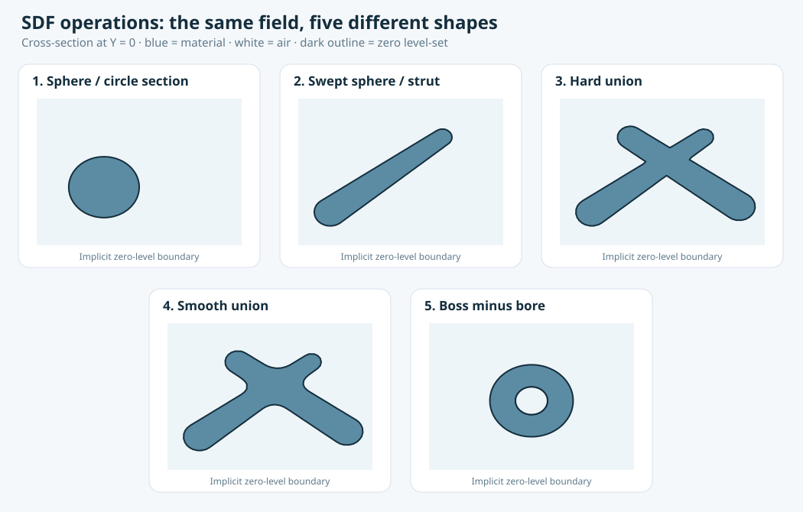

# 02 — A signed distance is a complete shape description

The most powerful idea in this project isn't a Blender modifier. It's that we can describe **a whole 3D solid with one number evaluated at each point**.

For a signed-distance field `d(p)`, negative means you're inside material, zero is the surface, and positive means you're in air. This is an *implicit representation*: rather than store faces directly, we define a rule for finding the boundary.



## First build a sphere

A sphere with center `c` and radius `r` has field:

```python
import numpy as np

def sphere_sdf(x, y, z, center, radius):
    cx, cy, cz = center
    return np.sqrt((x-cx)**2 + (y-cy)**2 + (z-cz)**2) - radius
```

Why does it work? At the center, the square root is zero, so `d=-r`. Exactly `r` millimeters away, `d=0` and we're on the surface. At a point beyond that, `d>0`.

For `c=(0,0,0)` and `r=4`: `d(0,0,0)=-4`; `d(4,0,0)=0`; `d(6,0,0)=2`. **Before you calculate:** what will `d(0,0,3)` be? Answer: `-1`.

## Sweep the sphere: a line becomes a capsule

Let `a` and `b` be the ends of a segment, and `p` any sampled point. We want the nearest point on the segment — not the nearest *endpoint* unless that really is closest.

```python
v = b - a
# Projection onto the infinite line; clamp to the finite segment.
t = np.clip(np.dot(p-a, v) / np.dot(v, v), 0, 1)
closest = a + t * v
distance = np.linalg.norm(p-closest) - radius
```

Read that step by step:

1. `v` is the vector from A to B.
2. The dot product computes **how far along** AB the projected point lies.
3. Dividing by `v·v` normalizes by squared segment length.
4. `clip(...,0,1)` protects the end caps, keeping the closest point on the finite segment.
5. Subtracting the radius expands that thin centerline into a solid strut.

The actual [`segment_distance()`](../organic/fields.py) broadcasts over NumPy grids, and optionally interpolates the radius from A to B. With equal radii, it describes a true capsule. With unequal radii, it is a useful **approximate tapered field**; its gradient isn't always a true signed distance to an ideal cone.

**Why no animated sphere?** You could move a Blender sphere and Boolean-union all the positions, but this field describes the continuous swept shape directly and tends to be much easier to blend and remesh.

## From one point to thousands

A one-point formula is interesting, but not a mesh. With NumPy, `np.meshgrid` creates coordinate arrays. The same formula is applied to every voxel location through broadcasting. The result is a 3D array of distances.

The mesh extraction step later finds the places between samples where the field changes sign. That's why resolution matters: a thin strut can be missed entirely if it is smaller than the sampling scale.

## Run the field lab

```bash
python -m organic.field_lab --out results/field_lab.png
```

Open the generated figure. Compare panel 1 (sphere) to panel 2 (capsule). Then inspect panels 3, 4, and 5. The blue-filled regions are the exact level-set sections computed by the functions used in the build engine.

**Experiment:** in `organic/field_lab.py`, change `radius=11` in the first `sphere_sdf()` call to `radius=15`. Why did the outline expand? Now adjust the capsule's endpoint radii. What stays fixed? The centerline endpoints.

**Knowledge check:** If a point has distance `+3 mm`, does the algorithm remove material or add it? Neither — the positive sign *describes the point as air*. Material is formed when we interpret all negative points as solid.

Next: [03 — Curves and branching](03-curves-and-branches.md).
