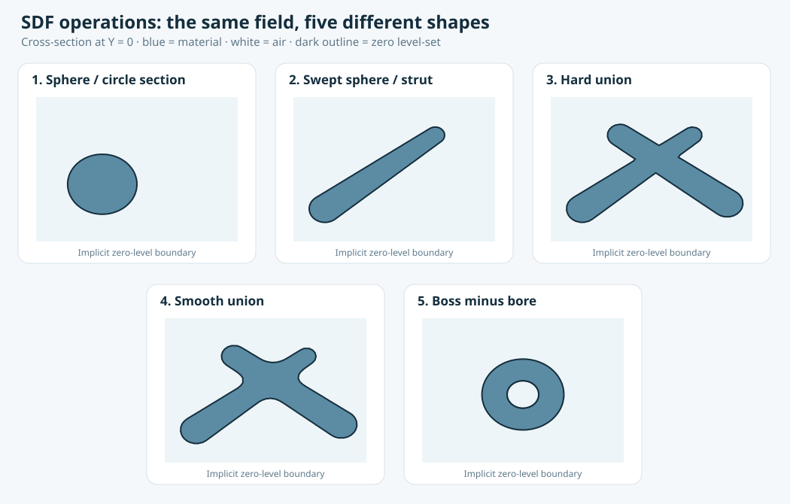

# 03 — Curves, taper, and organic branching

A perfectly straight rod between two bolts is easy to understand, but organic structures often bend around equipment and merge with neighboring load paths. Three parameters do most of the work here: **centerline, radius, and blend distance**.

## The quadratic Bézier centerline

For endpoints `A`, `B` and control point `C`:

\[P(t)=(1-t)^2A+2(1-t)tC+t^2B, \qquad 0\le t\le 1\]

The curve begins at A (`t=0`), passes *toward* C (usually not through C), and ends at B (`t=1`). At halfway, `P(.5)=.25 A+.5 C+.25 B`. That's a weighted average you can calculate without rendering anything.

In the build engine, a Bézier path is sampled into adjacent line segments. Each segment is turned into a capsule-like distance field, and their union forms an approximate curved beam.

**Two different kinds of resolution:**

- `samples` on a strut controls how closely straight mini-segments follow the ideal curve.
- `voxel_mm` controls how finely the *surface itself* is sampled before marching cubes.

More Bézier samples cannot repair a coarse voxel grid. Smaller voxels cannot fix a badly chosen control point.

## Taper changes material placement

With `radius_a_mm=5` and `radius_b_mm=3`, the radius varies along the segment: `r(t)=5+t*(3-5)`. At halfway, the target radius is 4 mm. The generator interpolates along the closest-point parameter, so this is a practical tapered implicit field rather than a precisely machined cone.

A reason to taper is to place more material near a boss and less in the middle of a path. But just because something *looks* like a bone does not mean the load case justifies that taper. For a real camera rig, bending moment, fastener reactions, fatigue, material direction and buckling still need analysis.

## What smooth union actually changes

A hard union of two negative-inside fields is `min(d1,d2)`. That joins the solids but can leave a sharp crease where the fields meet.

The implemented `smooth_union()` introduces a blend width `k` and rounds the intersection, typically adding a small amount of material near the junction. It is an approximate SDF operation. The blend is not a global subdivision modifier, and it doesn't smooth the entire model after meshing.

The difference is visible even before meshing. That's powerful: we can make branching behavior part of a reusable *equation* instead of hand-editing dozens of intersections.

## Controlled experiment

Create `examples/my_first_arm.json` from `examples/first_arm.json`, set `name` to `my_first_arm`, then:

1. Set the `control` of `base→upper` to `[14,0,28]`. Predict the centerline's movement.
2. Set `blend_mm` to `0`. Regenerate. Observe the harder-looking junctions.
3. Set `blend_mm` to `3`. Regenerate. What changed at intersections compared with the straight sections?
4. Restore the previous value. Increase `radius_a_mm` on `base→upper`, keeping the mounting-hole radius unchanged.

**Expected:** altering a control point primarily changes the path; altering `blend_mm` primarily changes overlap transitions; altering a radius changes the local material envelope. A single image isn't enough to measure strength.

**Check yourself:** Why does the engine join mounts *before* drilling holes? Because blending material after drilling could encroach on the hole. We'll make that explicit in the next chapter.

Next: [04 — Bosses and clearance constraints](04-constraints-and-holes.md).
