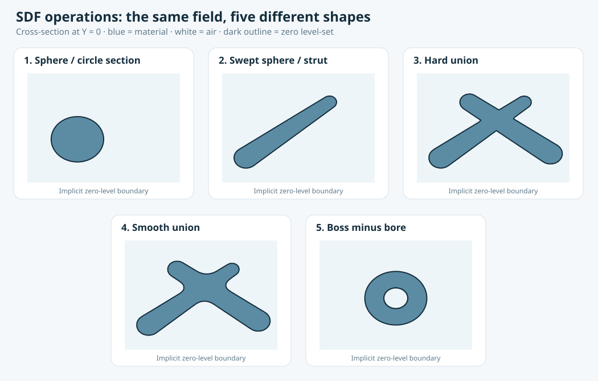

# 04 — Protected bosses, clear holes, and keep-outs

This is where organic geometry becomes engineering geometry. You can make wonderful curved branches, but if a bolt won't pass through a boss or a camera connector intersects the arm, the part fails its purpose.

## Positive and negative design regions

Think about an arm as three sets:

- **Required material:** mount bosses, attachment surfaces, protective rims.
- **Allowed material:** the space where struts may connect required regions.
- **Forbidden material:** bolt bores, connector approach paths, cable envelopes, moving-part sweeps.

The starter implements required bosses and Y-axis bolt bores. It doesn't yet implement arbitrary 3D keep-out solids or collision probes for your particular camera; that is an extension you'll eventually want.

## Two field operations, and why order matters

For two fields that use *negative = material*, a hard union is:

```python
union = np.minimum(a, b)
```

A difference is:

```python
remaining = np.maximum(solid, -cutter)
```

Why the minus sign? Inside the cutter, `cutter` is negative. Negating makes it positive there, and `max` forces the resulting field to describe *air*, regardless of the original solid.

The real builder uses a smooth union while creating struts and bosses, then applies hard cylinder differences **after** all positive solids have been combined. This protects the hole from later smoothing operations.



## Why boss and hole are different parameters

A mount entry includes `outer_radius_mm`, `hole_radius_mm`, and `width_mm`:

```json
{"node":"base", "outer_radius_mm":11, "hole_radius_mm":3.5, "width_mm":12}
```

That means a nominal outer boss radius of 11 mm, a 7 mm diameter drill field, and 12 mm boss width along Y. **It does not guarantee the exported STL's actual hole diameter**: marching-cubes discretization can shift or polygonize the boundary.

The nominal radial material around the bore is 7.5 mm before blending and other interactions. That's a geometric fact, not a fastener bearing-strength calculation.

## Run a safety-oriented experiment

On a copy of `examples/first_arm.json`:

1. Increase the base mount's `hole_radius_mm` from `3.5` to `4.0` (nominal diameter changes 7→8 mm).
2. Regenerate and inspect the center section.
3. Increase `outer_radius_mm` separately and regenerate. Observe that material increases around the bore but the hole remains a hard exclusion.
4. Deliberately make `hole_radius_mm` larger than `outer_radius_mm`. The input validator should reject that model instead of silently generating an impossible boss.

**Expected:** the hole size is independent of the decorative strut radii; the mount clearance constraints must be specified intentionally.

## For real hardware

A good production pipeline should import mounting coordinates and component keep-outs from FreeCAD or a measured mechanical drawing. Add a tolerance budget, print-orientation constraints, and checks for wall thickness/physical tool access. The starter doesn't pretend these are finished.

Next: [05 — Sampling, meshes and verification](05-mesh-and-verification.md).
